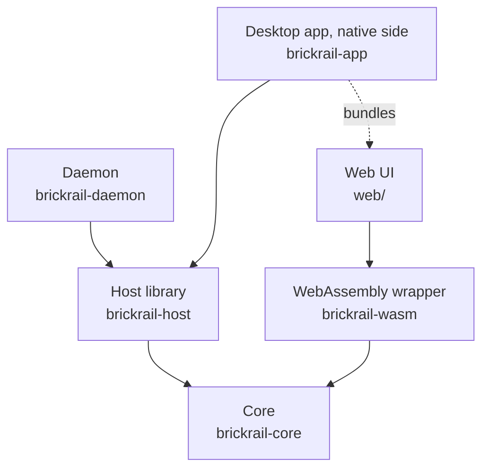

# Architecture

brickrail-2 is a library of pure components, the core, embedded by a few
programs, the hosts, and driven by one web UI. This file describes how those
parts fit; the [train simulation](train-simulation.md) describes what the
simulation does.

## Core and hosts

The **core** is a library of pure components: none has a clock, performs I/O,
or knows what sits on the other side of its inputs and outputs. It compiles to
WebAssembly as readily as to native code. Its components:

- the layout model, with the layout commands that edit it, their validation,
  and undo;
- geometry queries for the editor: snapping candidates, nearest track or
  endpoint, tracks in a region, the section between two tracks, and train
  positions interpolated for a given time;
- the **simulation**: the behaviour that moves trains, as described in the
  train simulation design;
- the **state mirror**: simulation state together with the one function that
  applies a state event to it;
- the virtual driver;
- the codec for the hub protocol.

A **host** is a program that embeds some of the core's components, passes
them time, performs all I/O, and routes: external happenings become core
inputs, core outputs go to their consumers. Three hosts exist: the daemon,
the desktop app's native side (the same code as the daemon, in one process),
and the browser, which loads the core as WebAssembly. Bluetooth to the hubs is
owned by the native hosts, in-process.

The daemon and the desktop app share one host library; the browser reaches
the core through a thin WebAssembly wrapper. Arrows point at what is depended
on; the dashed edge is the desktop app bundling the built UI into its webview.

## Layout, state and modes

The **layout** is the description of a physical layout: tracks, connections,
markers, blocks and train definitions. It is a single human-readable,
versioned file at a path the user chooses.

**Persistent state** is what survives across runs but is not part of the
layout, chiefly where each train stands. It is a sibling file beside the
layout: a cache, not a save file.

**Control state** is the simulation's runtime state, locks, leg queues, train
positions. It lives inside the simulation and is created fresh when control
mode begins.

The host that runs the simulation owns the layout and persistent-state files;
the UI opens and saves through it.

The application is in one of two modes. In **edit mode** the user changes the
layout through layout commands and no simulation runs. In **control mode** the
layout is handed to the simulation and does not change while it runs; the
user issues control commands and watches state events arrive. The simulation
always assumes a static layout.

## Commands, events and time

A **command** is the only way anything outside the core changes core state,
whether it comes from the UI, a script or a test. A **layout command** edits
the layout, is valid in edit mode, and is undoable. A **control command**
asks the simulation for something, is valid in control mode, and is answered
with a response.

The simulation's inputs are control commands and marker hits; its outputs are
[state events](train-simulation.md) and driver instructions. The simulation
changes its own state only by applying the events it emits through the state
mirror, so the event stream is complete by construction, and any holder of a
mirror that applies the same events holds the same state. Clients therefore
embed a mirror and run no simulation behaviour.

Time enters the simulation only as the current time carried on each input.
The simulation may ask its host to wake it at a deadline; the host never
exposes a clock to it.

Driver instructions are routed by the host to the train's driver, the virtual
driver or a hub; marker hits come back the same way. The simulation does not
know which it is talking to.

## Deployments

- **Desktop app**: UI, simulation and Bluetooth in one program on the machine
  by the layout. The first target.
- **Daemon and remote client**: the daemon runs by the layout and serves the
  UI over the local network; any browser on the network is a client. One URL,
  no accounts, no encryption.
- **Browser only**: the browser hosts the whole core and runs virtual trains
  without any daemon.

Client and simulation exchange commands, state events and responses over a
single socket. On connect the client receives a snapshot of simulation state
and then the live stream. The UI and the host it talks to always ship as one
build, so the socket's protocol is not versioned; only the files are.

## The UI

One UI codebase runs in the browser and inside the desktop app. It holds
**interaction state** only: the active tool, the selection, hover, and the
picks of an edit in progress. Everything else it shows comes from the core:
layout and simulation state as views, pointer positions resolved through
geometry queries, train positions already interpolated. It writes only through
commands; an edit in progress accumulates in the UI and flushes as one
command. It makes no assumptions that would bind it to a desktop, such as a
mouse with hover, so that touch devices and browser-direct hardware control
remain open.
