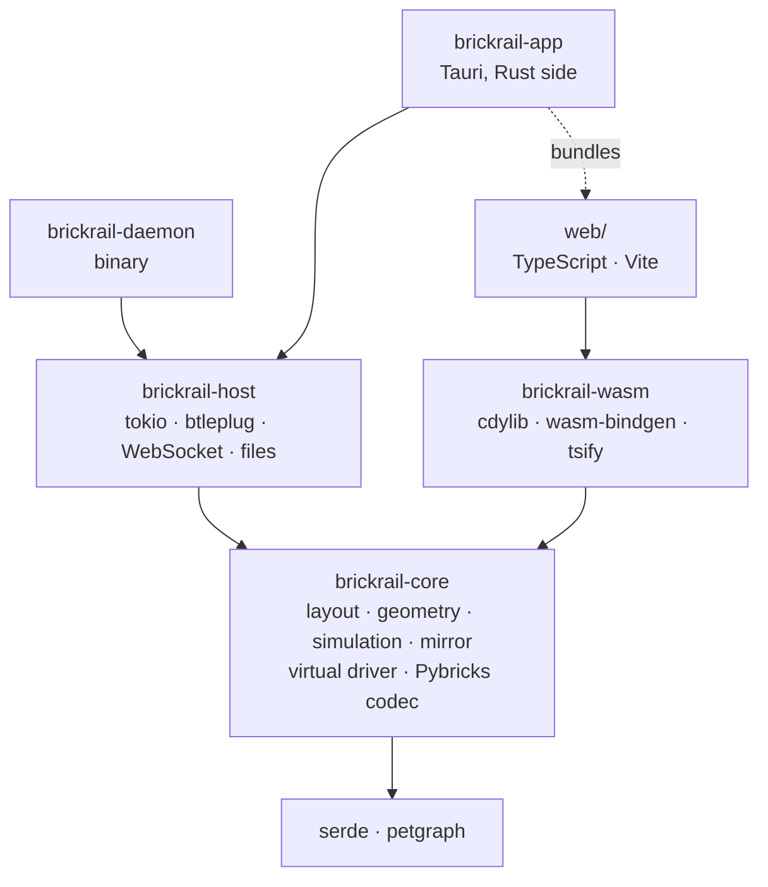

# Tech stack reset — round 3

Builds on [round 2](round-02.md): time as `now` on inputs, Tauri in-process,
the wasm core from day one, WebSocket with JSON. This round settles files,
what edit mode looks like inside the core, the crate layout, and how a browser
reaches the daemon.

### Q9 — Files: the layout, persistent state, and who owns them

No database, so three things are files. The layout struct is already a serde
struct of element lists (tracks, connections, markers, blocks, trains); nothing
reads or writes it yet.

(a) **Layout file.** JSON, pretty-printed with stable key order so it diffs in
git, with a format version field. The user picks the path. Alternatives: RON
(Rust-flavoured, less tooling), or a binary format (not hand-inspectable).

(b) **Persistent state** (train block positions, per the design a cache, not a
save file). Two placements: beside the layout as `<layout>.state.json`, so it
travels with the layout and is obviously about it; or in the platform cache
directory keyed by layout path, so the layout folder stays clean and the
cache is disposable. In browser-only mode it would be local storage either way.

(c) **Who owns the files in the daemon deployment.** The user edits in a
browser on the laptop; the simulation runs on the Pi. Either the daemon owns
the layout file (it lives on the Pi, the UI opens and saves it through the
host over the wire, and the Pi is the layout's home) or the browser does (the
layout is uploaded on entering control mode and downloaded to save, the Pi
holds nothing). In the Tauri app the host is local, so this is invisible
there: native dialogs, files on disk.

Which for each?

➡️ (a) JSON, pretty-printed, versioned. (b) Beside the layout as a sibling
file; a cache directory keyed by path breaks the moment the layout moves. (c)
The host that runs the simulation owns the files, so the daemon's machine is
the layout's home and the UI is always a client of a host, which keeps the
Tauri and browser paths identical.

> yes

---

### Q10 — Edit mode inside the core

Narrows [Q7](round-02.md). With the core in wasm, the natural shape is that
the layout under edit lives in the core too: TypeScript issues layout commands
(add track, create block from two picks, set passthrough speed), the core
validates, applies, and keeps the undo history; TypeScript asks for a view to
draw and holds only interaction state (active tool, selection, hover,
in-progress picks). The old client design's headless versus visual split then
maps exactly onto core versus TypeScript.

Three things to confirm:

(a) Layout commands, validation and undo live in the core; TypeScript never
mutates layout data directly. Edit-mode commands and control-mode commands
are the same kind of thing, inputs to a core component, gated by mode.

(b) Geometry queries live in the core: snapping candidates for an endpoint,
nearest track or endpoint to a point, tracks in a rectangle, section between
two picked tracks. TypeScript turns pointer events into these queries and
their results into commands.

(c) Position interpolation is a core query too, `positions_at(now)` against
the mirror, so the renderer draws what the core computes and never reasons
about legs or markers itself.

➡️ All three. It is the geometry-in-core rule made concrete, and it means the
TypeScript side holds no model of tracks beyond what it draws.

> yup. but simulation should always be able to assume a static layout

---

### Q11 — Crate layout and the shared host library

The daemon and the Tauri backend run the same code in-process (Q6), so that
code is a library both link. Proposed workspace:

- `brickrail-core`: the pure components. Layout model and layout commands,
  geometry, simulation, state mirror, virtual driver, Pybricks codec. No I/O,
  no async, no clock, compiles to wasm.
- `brickrail-wasm`: a `cdylib` wrapper exporting the core to the browser with
  `wasm-bindgen` and `tsify`. No logic.
- `brickrail-host`: the host library. tokio runtime, routing, timers, BLE via
  btleplug, WebSocket server, file I/O, the serving of the web UI bundle.
- `brickrail-daemon`: a binary over the host library.
- `brickrail-app`: the Tauri project, its Rust side over the host library.
- `web/`: the TypeScript UI, Vite, consuming `brickrail-wasm`.

Dependency graph (arrows point at what is depended on):

Two roots, one leaf. The daemon and the Tauri app are the native hosts over
the host library; the web UI is the browser host over the wasm wrapper. The
core depends on nothing but serde and petgraph and is reached only through
those two wrappers. The dashed edge is the Tauri app bundling the built web
UI into its webview; it is a build-time inclusion, not a Rust dependency.

Dev shell additions: the wasm32 target, `wasm-bindgen-cli` pinned to the
crate version, Node, and Tauri's Linux build dependencies.

Is that the layout? Anything you want merged (core and wasm as one crate with
a feature) or split (geometry its own crate)?

➡️ Yes as listed. Keep the wasm wrapper a separate crate so the core never
grows a `wasm-bindgen` dependency or `cfg` branches; keep geometry inside the
core, since the simulation and the editor share the track model.

> yup

---

### Q12 — Reaching the daemon from a browser

In the daemon deployment someone opens a browser on the laptop. Proposal: the
daemon serves the built web UI as static files over HTTP and the WebSocket on
the same port, so the deployment is "open `http://<pi>:<port>`". LAN only, no
authentication, no TLS, configurable port, discovery by typed address. mDNS
discovery and any access control are later inbox items if ever wanted.

Web Bluetooth, out of scope but not to be designed against, requires a secure
context: HTTPS or localhost. The Tauri shell serves from its own origin, and
a browser-only mode on localhost qualifies, so this does not block it.

Alternatives:

- **UI hosted elsewhere, daemon only a WebSocket.** The UI lives on a static
  host and connects to a typed daemon address. UI updates ship independently
  and the Pi carries no bundle. But a page served over HTTPS cannot open a
  plain WebSocket to a LAN daemon, so the daemon would need TLS with a
  self-signed certificate, and UI and daemon protocol versions can skew.
- **Vite dev server proxying to the daemon.** Development workflow, not a
  deployment; exists regardless.
- **The native app as the remote client.** The Tauri app connecting to a
  remote daemon instead of its in-process host. Cheap, since the UI already
  talks to a host through one abstraction; an inbox item, not part of this.
- **Discovery:** typed address; mDNS so the browser finds the daemon by name;
  the daemon printing its URL and a QR code at startup.
- **Access:** none; a token in the URL; a password; TLS with a self-signed
  certificate.
- **A reverse proxy on the Pi** in front of the daemon. Overkill for one
  process.

Is "daemon serves the UI, plain HTTP on the LAN, no auth" the whole story for
the reset?

➡️ Yes. It is the simplest thing that makes deployment 2 a single process
with a URL, and nothing in it forecloses TLS or auth later.

> yes
